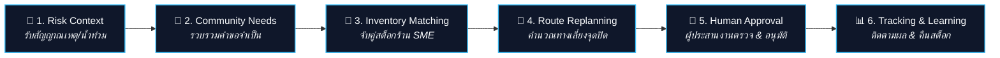
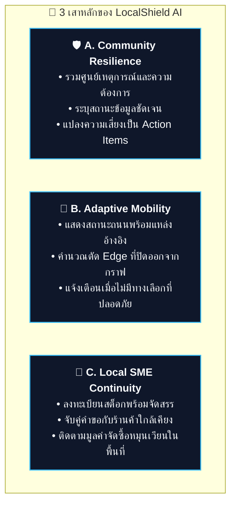
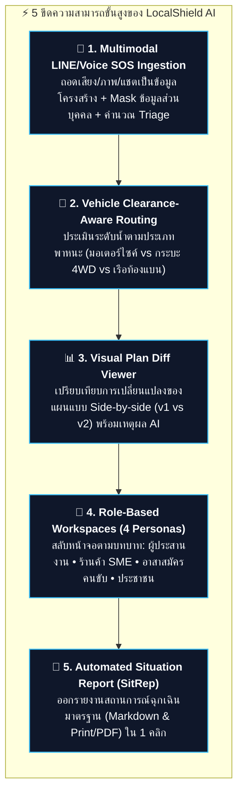
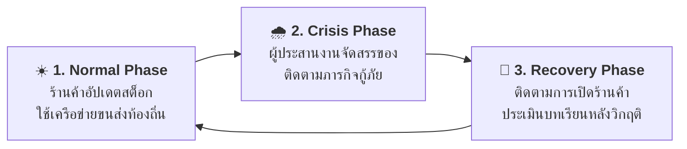
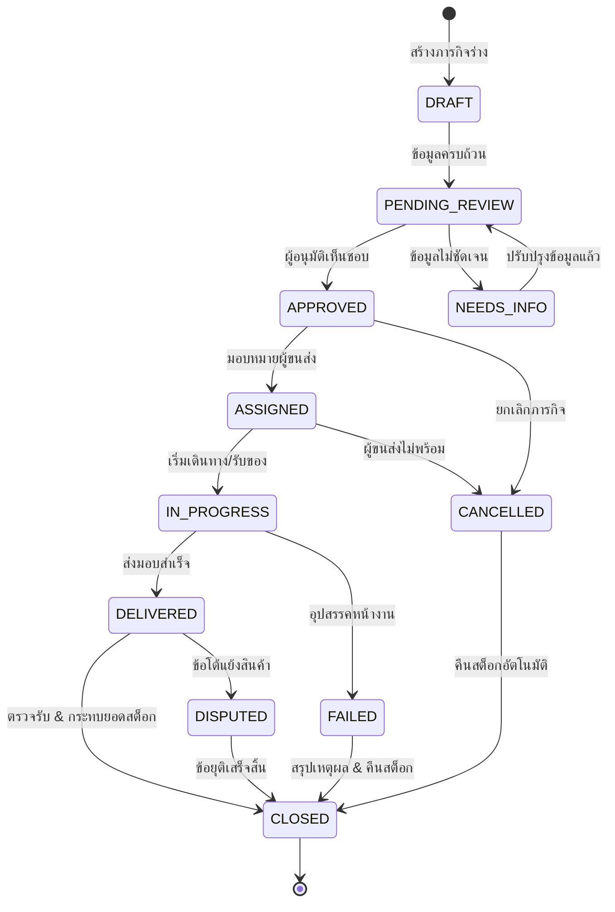

# 🛡️ LocalShield AI — Final Idea Proposal
### AI-Assisted Community Relief Coordination & Local Economic Continuity
> **Tagline:** *"Protect Communities. Keep Local Economies Moving."*

---

| 📋 มิติโครงการ | 🔍 รายละเอียด |
| :--- | :--- |
| **ชื่อโครงการ** | **LocalShield AI** |
| **คำอธิบายแนวคิด** | ระบบช่วยประสานงานจัดสรรสินค้าจำเป็นและสิ่งของบรรเทาทุกข์ในภาวะวิกฤติ เชื่อมโยงสต็อกร้านค้า SME ชุมชน และเส้นทางการขนส่งที่ปรับตัวได้ |
| **เวอร์ชันเอกสาร** | **v2.1** \| 28 ตุลาคม 2026 |
| **สถานะผลิตภัณฑ์** | `Concept` + `Interactive HTML Prototype` *(Synthetic Demonstration Data Only)* |
| **ขอบเขตการตัดสินใจ** | ขอความเห็นชอบเพื่อพัฒนา **MVP สำหรับทดสอบ Workflow** (ยังไม่ใช่ระบบ Dispatch ภาคสนามจริง) |

---

> [!IMPORTANT]
> ### 💡 Executive Summary & Core Pitch
> **One-line pitch:** LocalShield AI turns community needs, local inventory and verified road constraints into explainable, human-approved relief allocation plans—so essential goods can keep moving when normal routes are disrupted.
>
> เมื่อเกิดน้ำท่วมหรือเหตุที่ทำให้ถนนบางช่วงใช้การไม่ได้ ชุมชนอาจยังมีร้านค้าที่มีน้ำดื่ม อาหารแห้ง และของจำเป็น แต่ผู้ประสานงานต้องรวบรวมข้อมูลคำขอ สต็อกสินค้า สถานะถนน และผู้ขนส่งจากหลายช่องทาง **LocalShield AI** เสนอระบบช่วยประสานข้อมูลเหล่านี้เป็นแผนจัดสรรและจัดส่งที่ตรวจสอบเหตุผลได้ พร้อมให้ผู้รับผิดชอบตรวจและอนุมัติก่อนดำเนินการ
>
> LocalShield AI **ไม่ใช่เพียงแอปแจ้งเตือนน้ำท่วม** และ **ไม่ได้อ้างว่าพยากรณ์ระดับน้ำรายซอยหรือรับรองเส้นทางปลอดภัยได้** ระบบมุ่งแก้ช่วงต่อระหว่าง:
> **รู้ว่ามีความเสี่ยง ➔ รู้ว่าใครต้องการอะไร ➔ รู้ว่าร้านไหนมีสินค้า ➔ ตรวจข้อจำกัดเส้นทาง ➔ เสนอแผน ➔ ให้คนอนุมัติ ➔ ติดตามผล**



---

## 📑 สารบัญเอกสาร (Table of Contents)

* [ส่วนสรุปผู้บริหารและสมมติฐาน (Executive Summary & Assumptions)](#executive-summary)
  * [Decision Requested](#decision-requested)
  * [Assumptions for the MVP](#assumptions-for-the-mvp)
* [1. ปัญหาและกลุ่มผู้ใช้เป้าหมาย (Problem Statement & Target Users)](#1-problem-statement)
  * [Problem Hypothesis](#problem-hypothesis)
  * [Target Users](#target-users)
  * [Current Workflow vs Proposed Workflow](#current-workflow-vs-proposed-workflow)
* [2. แนวทางแก้ปัญหาและกระบวนการทำงาน (Proposed Solution & Workflow)](#2-proposed-solution)
  * [A. Community Resilience](#a-community-resilience)
  * [B. Adaptive Mobility & Relief Logistics](#b-adaptive-mobility--relief-logistics)
  * [C. Local SME Continuity](#c-local-sme-continuity)
  * [Workflow การทำงาน 7 ขั้นตอน](#workflow)
* [3. ความสอดคล้องกับทิศทางผลิตภัณฑ์ AI (Fit to AI Product / Hackathon Directions)](#3-fit-to-ai-product--hackathon-directions)
* [4. ความแปลกใหม่และการเปรียบเทียบเชิงแข่งขัน (Novelty & Competitive Differentiation)](#4-novelty--competitive-differentiation)
* [5. สถาปัตยกรรมทางเทคนิค (Technical Architecture)](#5-technical-architecture)
  * [Proposed Tech Stack](#proposed-stack-not-yet-integrated-in-the-prototype)
  * [Clear Separation of Responsibilities](#clear-separation-of-responsibilities)
* [6. ขอบเขต MVP และสิ่งที่ยังไม่ได้ทำ (Current MVP and Scope Boundaries)](#6-current-mvp-and-scope-boundaries)
  * [What the Prototype Demonstrates vs What It Does Not Do](#what-the-current-html-prototype-demonstrates)
  * [Synthetic Demo Setup](#synthetic-demo-setup)
* [7. ตัวชี้วัดผลกระทบและแผนการทดสอบ (Impact, KPIs & Validation Plan)](#7-impact-kpis--validation-plan)
  * [KPI Matrix](#7-impact-kpis--validation-plan)
  * [Pilot Plan (5 ขั้นตอน)](#pilot-plan)
* [8. ความยั่งยืนและความเป็นไปได้ทางธุรกิจ (Sustainability & Viability)](#8-sustainability--viability)
  * [Year-round Value Hypothesis](#year-round-value-hypothesis)
  * [Possible Funding Models to Validate](#possible-funding-models-to-validate)
* [9. ความปลอดภัย ความเป็นส่วนตัว และความน่าเชื่อถือ (Safety, Privacy & Reliability)](#9-safety-privacy--reliability)
* [10. ทีมงานและความรับผิดชอบ (Team & Responsibilities)](#10-team--responsibilities)
* [11. ทะเบียนหลักฐานการกล่าวอ้าง (Evidence Ledger)](#11-evidence-ledger)
* [12. แหล่งข้อมูลอ้างอิง (References)](#12-references)
* [ภาคผนวก (Appendices)](#ภาคผนวก-appendices)
  * [Appendix A: Detailed User Journeys and Operational States](#appendix-a-detailed-user-journeys-and-operational-states)
  * [Appendix B: Data Model and Data Quality Policy](#appendix-b-data-model-and-data-quality-policy)
  * [Appendix C: Planning Logic, Explainability and Fairness](#appendix-c-planning-logic-explainability-and-fairness)
  * [Appendix D: API and Integration Blueprint](#appendix-d-api-and-integration-blueprint)
  * [Appendix E: Security, Privacy and Operational Controls](#appendix-e-security-privacy-and-operational-controls)
  * [Appendix F: Delivery Plan and Acceptance Criteria](#appendix-f-delivery-plan-and-acceptance-criteria)
  * [Appendix G: Risks, Dependencies and Open Questions](#appendix-g-risks-dependencies-and-open-questions)
  * [Appendix H: Glossary (คำศัพท์สำคัญ)](#appendix-h-glossary)

---

## Executive Summary

เมื่อเกิดน้ำท่วมหรือเหตุการณ์ที่ทำให้เส้นทางคมนาคมบางช่วงถูกตัดขาด ชุมชนยังอาจมีร้านค้าในพื้นที่ที่มีสต็อกน้ำดื่ม อาหารแห้ง เวชภัณฑ์ และสิ่งของจำเป็น แต่ปัญหาใหญ่คือ **ผู้ประสานงานต้องรวบรวมข้อมูลอย่างกระจัดกระจาย** จากทั้งโทรศัพท์ แชตกลุ่ม บันทึกสต็อกของร้านค้า และรายงานสภาพถนนที่ยังไม่ได้รับการยืนยัน

**LocalShield AI** ได้รับการออกแบบให้เป็น **Coordination Workspace** ที่รวบรวมข้อมูลความต้องการ ตรวจสอบสต็อกร้านค้าในพื้นที่ วิเคราะห์ข้อจำกัดของเส้นทาง แล้วสร้างข้อเสนอแผนจัดสรรและกระจายของบรรเทาทุกข์ที่ **ตรวจสอบที่มาได้ (Explainable)** พร้อมให้ผู้มีอำนาจตัดสินใจตรวจทานและอนุมัติก่อนสั่งการจริง

> [!NOTE]
> **Core Workflow Sequence:**  
> `Risk Context` ➔ `Needs` ➔ `Inventory Matching` ➔ `Route Replanning` ➔ `Human Approval` ➔ `Tracking & Learning`

### Decision requested

เอกสารนี้เสนอให้เห็นชอบการพัฒนา **MVP เพื่อทดสอบ workflow** ไม่ใช่การเปิดใช้ระบบ dispatch จริงในภาคสนามทันที โดยเป้าหมายของรอบถัดไปคือพิสูจน์ 3 ประเด็น:
1. **Usability:** ผู้ประสานงานเข้าใจและใช้แผนที่ระบบเสนอได้จริงหรือไม่
2. **Constraint Honoring:** แผนที่ระบบสร้างเคารพข้อจำกัดสต็อกและถนนตามข้อมูลที่ป้อนหรือไม่
3. **Data Cadence:** ร้านค้าและผู้ขนส่งยินยอมอัปเดตข้อมูลในความถี่ที่ workflow ต้องใช้หรือไม่

### Assumptions for the MVP

| สมมติฐานหลัก | ผลต่อการออกแบบระบบ | สิ่งที่ต้องยืนยันก่อนเริ่ม Pilot |
| :--- | :--- | :--- |
| **มีผู้ประสานงานที่มีสิทธิ์อนุมัติภารกิจ** | ระบบออกแบบให้ทุกแผนอยู่ในสถานะร่าง (`DRAFT`) ก่อนอนุมัติเสมอ | กำหนดบทบาท ผู้อนุมัติสำรอง และ SLA เวลาตอบรับ |
| **ร้านค้ายินยอมแจ้งสต็อกที่จัดสรรได้** | สต็อกในระบบคือ `allocatable stock` ไม่ใช่สต็อกรวมทั้งหมดของร้าน | ความถี่ในการอัปเดตและวิธีแก้ไขข้อมูลกรณีคลาดเคลื่อน |
| **สถานะถนนมาจากแหล่งที่ระบุได้** | Routing engine ใช้เฉพาะข้อจำกัดที่บันทึกเป็นข้อมูลโครงสร้าง | ผู้รับรองสถานะถนน, อายุข้อมูลสูงสุด (TTL) และช่องทางแจ้งเหตุ |
| **การส่งมอบจริงอยู่ภายใต้หน่วยงาน/ผู้ขนส่ง** | MVP ไม่สั่งงานหรือตัดเงินอัตโนมัติ | SOP การรับมอบสินค้า, การยืนยันส่งสำเร็จ และขอบเขตความรับผิดชอบ |

---

## 1. Problem Statement

### Problem hypothesis

ในเหตุฉุกเฉิน ข้อมูลที่จำเป็นต่อการจัดสรรสิ่งของมักแยกส่วนอยู่ในรายงานภัยพิบัติ, โทรศัพท์หรือแชตของชุมชน, รายการสินค้าของร้านค้า และข้อมูลสภาพถนน ผู้ประสานงานจึงต้องรวบรวมข้อมูลด้วยตนเองและปรับแผนซ้ำๆ เมื่อเงื่อนไขหน้างานเปลี่ยนไป

> [!NOTE]
> นี่เป็น **สมมติฐานปัญหาที่ต้องตรวจสอบกับผู้ใช้จริง** ไม่ใช่ข้อสรุปจากการสำรวจทางสถิติที่ทีมยืนยันแล้ว

### Target users

* **ผู้ใช้หลัก (Primary User):** ผู้ประสานงานชุมชนหรือองค์กรท้องถิ่น ที่ทำหน้าที่รับคำขอ จัดลำดับความสำคัญ และอนุมัติภารกิจ
* **ผู้ใช้รอง 1 (Secondary User 1):** ร้านค้า SME ที่ลงทะเบียนรายการสินค้า สต็อกคงเหลือ เวลาทำการ และสถานะความพร้อม
* **ผู้ใช้รอง 2 (Secondary User 2):** ผู้ขนส่งหรืออาสาสมัครที่ได้รับมอบหมาย ซึ่งต้องเห็นจุดรับส่งและข้อจำกัดถนนที่มีหลักฐานอ้างอิง
* **ผู้ได้รับประโยชน์ (Beneficiaries):** ประชาชนในชุมชนที่ต้องการสินค้าจำเป็นและสามารถเข้าถึงสถานะคำขอของตนเองได้

### Current workflow vs proposed workflow

| ขั้นตอนการดำเนินงาน | กระบวนการที่มักเกิดขึ้นในปัจจุบัน (ต้องยืนยัน) | กระบวนการของ LocalShield AI ที่นำเสนอ |
| :--- | :--- | :--- |
| **1. รับข้อมูลเหตุการณ์** | ติดตามข่าวสารและข้อมูลกระจัดกระจายหลายแหล่ง | รวมศูนย์เหตุการณ์พร้อมระบุ Source, Timestamp และสถานะความสด |
| **2. รับคำขอความช่วยเหลือ** | รวมข้อมูลจากโทรศัพท์, ข้อความแชต, สมุดจด | บันทึกคำขอเป็น Structured Data ที่ติดตามสถานะและตรวจสอบได้ |
| **3. ค้นหาสินค้าจำเป็น** | โทรศัพท์สอบถามร้านค้าทีละแห่งแบบสุ่ม | ค้นหาสต็อกที่ลงทะเบียนในระบบ พร้อมเวลาปรับปรุงล่าสุด |
| **4. วางแผนเส้นทางขนส่ง** | ผู้ขนส่งและผู้ประสานงานต่างคนต่างหาทางเลี่ยง | คำนวณทางเลือกจากกราฟถนนจำลอง พร้อมตัดเส้นทางที่ปิดออกทันที |
| **5. อนุมัติและติดตามงาน** | สถานะกระจายตามแชต ไม่มีการกระทบยอด | ผู้ประสานงานตรวจอนุมัติเป็นลายลักษณ์อักษร และบันทึก Audit Log |

---

## 2. Proposed Solution

LocalShield AI เป็น **AI-assisted coordination workspace** สำหรับการจัดสรรสินค้าจำเป็นในสถานการณ์ที่การเดินทางถูกรบกวน โดยแบ่งเป็นสามเสาหลักของผลิตภัณฑ์ *(เป็นการจัดกรอบแนวคิดของทีม ไม่ใช่การยืนยันว่าเป็นชื่อ Track อย่างเป็นทางการของการแข่งขัน)*:



### A. Community Resilience
* รับข้อมูลเหตุการณ์และความต้องการของชุมชน
* แสดงแหล่งที่มา เวลาที่อัปเดต และสถานะข้อมูลอย่างโปร่งใส เช่น `OBSERVED`, `FORECAST`, `ESTIMATED`, `SIMULATED`
* ช่วยแปลงข้อมูลความเสี่ยงเป็นรายการสิ่งที่ต้องตรวจสอบหรือเตรียมพร้อมหน้างาน

### B. Adaptive Mobility & Relief Logistics
* แสดงสถานะถนนจากข้อมูลที่มีแหล่งที่มาและระดับการยืนยัน
* คำนวณเส้นทางใหม่ทันทีเมื่อมีการยืนยันว่าถนนปิด โดยตัด Edge ที่ปิดออกจากกราฟการเดินทาง
* แสดงเหตุผลของแผนและแจ้งเตือนเมื่อไม่มีเส้นทางที่เป็นไปได้ แทนการสร้างคำตอบขึ้นมาเองโดยไม่มีหลักฐาน

### C. Local SME Continuity
* ให้ร้านค้าที่เข้าร่วมลงทะเบียนประเภทสินค้า จำนวนคงเหลือที่พร้อมจัดสรร (`allocatable stock`) และเวลาอัปเดต
* จับคู่คำขอกับร้านค้าที่มีสินค้าและเข้าถึงได้ตามข้อจำกัดของเส้นทาง
* แสดงมูลค่าการจัดซื้อจำลองและสถานะร้านค้าเพื่อใช้วางแผนฟื้นตัว *(โดยไม่เรียกมูลค่าจัดซื้อว่าเป็นกำไรหรือรายได้สุทธิ)*

### Workflow การทำงาน 7 ขั้นตอน

1. **เลือกสถานการณ์:** ผู้ประสานงานเลือกเหตุการณ์หรือสร้างสถานการณ์จำลอง
2. **ประเมินความต้องการ:** ระบบแสดงคำขอสินค้าและระดับความสำคัญตามกฎที่เปิดเผยได้
3. **จับคู่สต็อก:** ระบบค้นหาร้านค้าที่มีสต็อกเพียงพอ โดยพิจารณาความสดของข้อมูลประกอบ
4. **คำนวณเส้นทาง:** Routing Engine คำนวณเส้นทางบนกราฟถนนและตัดถนนที่ถูกปิดออก
5. **วิเคราะห์และอธิบาย:** AI ช่วยสรุปเหตุผล ข้อจำกัด และข้อมูลที่ยังขาด ส่วนการคำนวณเชิงปริมาณใช้ Deterministic Logic
6. **การอนุมัติโดยมนุษย์:** ผู้มีอำนาจตรวจทานรายละเอียดและกดยืนยันอนุมัติแผนก่อนเริ่มภารกิจ
7. **ติดตามและประเมิน:** ผู้ประสานงานติดตามสถานะงาน และตรวจสอบ KPI หลังจบเหตุการณ์

### 2.2 ขีดความสามารถขั้นสูงที่ได้รับการพัฒนาเพิ่ม (5 Enhanced Core Capabilities)

เพื่อยกระดับจากระบบประสานงานเชิงทฤษฎีสู่ระบบที่ตอบสนองสถานการณ์ฉุกเฉินในภาคสนามได้อย่างสมบูรณ์ LocalShield AI ได้รับการออกแบบและพัฒนาเพิ่ม 5 ขีดความสามารถสำคัญ:



#### 1. 🔴 Visual Plan Diff Viewer (การตรวจทานความเปลี่ยนแปลงของแผนเชิงเปรียบเทียบ)
* **ปัญหาหน้างาน:** เมื่อเกิดเหตุน้ำท่วมตัดถนนใหม่ การคำนวณแผนใหม่ทั้งระบบมักสร้างความสับสนให้ผู้ประสานงาน (Cognitive Overload) เนื่องจากไม่ทราบว่าคำร้องใดบ้างที่ถูกเปลี่ยนเส้นทาง หรือร้านค้าใดถูกสลับ
* **กลไกการทำงาน:**
  * ระบบบันทึก Snapshot ของแผนเวอร์ชันก่อนหน้า (`v_prev`) เทียบกับแผนเวอร์ชันปัจจุบัน (`v_curr`)
  * แสดงตารางเปรียบเทียบเชิงลึก: รายการคำร้อง, ร้านค้าเดิม ➔ ร้านค้าใหม่, เส้นทางเดิม ➔ เส้นทางเลี่ยงใหม่
  * คำนวณตัวชี้วัดผลกระทบสุทธิ (Net Delta): ระยะทางรวมที่เพิ่มขึ้น (+Δ km), เวลาที่คาดว่าจะล่าช้า, และคำร้องที่หลุดเข้าสู่ Exception Queue
  * **Explainable AI Rationale:** แสดงคำอธิบายที่ตรวจสอบได้ เช่น *"ถนนช่วง B–D ปิดใช้งาน จึงเปลี่ยนจุดเบิกสต็อกน้ำดื่มไปยังร้าน A และใช้เส้นทางเลี่ยง A ➔ C ➔ D (+2.4 กม.) เพื่อหลีกเลี่ยงจุดวิกฤต"*

#### 2. 🔴 Vehicle Clearance-Aware Routing (การนำทางตามขีดความสามารถยานพาหนะและระดับน้ำท่วม)
* **ปัญหาหน้างาน:** น้ำท่วมในเขตเมืองไม่ได้ปิดกั้นทุกยานพาหนะเท่าเทียมกัน น้ำท่วม 40 ซม. ขวางมอเตอร์ไซค์และรถเก๋ง แต่รถกระบะยกสูง 4WD หรือเรือท้องแบนกู้ภัยสามารถปฏิบัติการได้
* **การจัดระดับขีดความสามารถ (Clearance Thresholds):**
  1. `🏍️ มอเตอร์ไซค์ / เดินเท้า (Clearance < 15 ซม.):` ห้ามผ่านถนนที่มีน้ำท่วมขังเด็ดขาด บังคับใช้ทางเลี่ยงที่ปลอดภัยเท่านั้น
  2. `🛻 รถกระบะยกสูง / 4WD (Clearance < 45 ซม.):` สามารถลุยน้ำระดับปานกลางได้ แต่หากระดับน้ำวิกฤต (>40 ซม.) ระบบจะคำนวณทางเลี่ยงเพื่อความปลอดภัยของสินค้าและยานพาหนะ
  3. `🚤 เรือท้องแบน / เจ็ทสกีกู้ภัย (Wading Depth > 30 ซม.):` **สามารถสัญจรทางน้ำตัดตรงผ่านช่วงถนนที่ถูกน้ำท่วม (เช่น ช่วง B–D) ได้โดยตรง** กลายเป็นทางลัดพิเศษที่ช่วยลดระยะเวลาขนส่งได้มากกว่าการอ้อมทางบก

#### 3. 🟡 Multimodal LINE/Voice SOS Ingestion with Automated PDPA Redaction
* **ปัญหาหน้างาน:** ผู้ประสบภัยหรือผู้นำชุมชนในภาวะวิกฤตไม่สะดวกกรอกแบบฟอร์ม มักส่งข้อความแชตสั้นๆ, อัดเสียง (Voice Note) หรือส่งรูปถ่ายน้ำท่วม
* **กระบวนการประมวลผลของ AI:**
  * **Speech-to-Text & Vision OCR:** ถอดเสียงและแปลงข้อความดิบ เช่น *"บ้านยายแมว ซอย 4 น้ำท่วมอก มีคุณยายติดเตียง ต้องการน้ำดื่มด่วน 3 แพ็ค ข้าวสาร 2 ถุง โทร 089-123-4567"*
  * **Automated PDPA Masking:** ตรวจจับข้อมูลส่วนบุคคล (PII) อัตโนมัติและเข้ารหัส เช่น `089-123-4567` ➔ `[REDACTED: 089-XXX-4567]` ก่อนส่งเข้าสู่โมเดลและบันทึกในฐานข้อมูล
  * **Entity & Geocoding Extraction:** สกัดพิกัดพื้นที่ (ชุมชนบ้านเหนือ / Node D) และสิ่งของจำเป็น (น้ำดื่ม 3, อาหารแห้ง 2)
  * **Vulnerability Triage Scoring (0.0 - 10.0):** หากตรวจพบกลุ่มเปราะบาง (ผู้ป่วยติดเตียง, เด็กอ่อน, ผู้ป่วยฟอกไต) ระบบจะปรับคะแนนความเร่งด่วนสู่ระดับวิกฤต (Critical Triage Score 9.8/10) และยกระดับคิวคำร้องเป็น High Priority ทันที

#### 4. 🟡 Role-Based Operational Workspaces (ระบบสวมบทบาทตามผู้มีส่วนได้ส่วนเสีย 4 ฝ่าย)
ระบบรองรับการสลับมุมมองตามบทบาทการทำงานจริงในระบบนิเวศบรรเทาทุกข์:
1. **🛡️ ผู้ประสานงาน (Coordinator Dashboard):** ศูนย์บัญชาการ แผนที่ยุทธวิธี ตรวจรับรองสถานะถนน คิวคำร้อง และการอนุมัติแผนภารกิจ
2. **🏪 ร้านค้าชุมชน (Local SME Merchant Portal):**
   * แสดงเฉพาะรายการสินค้าที่ระบบจับคู่เบิกจ่ายจากร้านตนเอง
   * สรุป **ยอดเงินชดเชยที่การันตีโดยกองทุนบรรเทาทุกข์ (Guaranteed Escrow Payout)** พร้อมรหัส Digital Voucher
   * แผงปรับสต็อกคงเหลือแบบเรียลไทม์ (Quick Stock Sync) และปุ่มยืนยันสินค้าพร้อมส่งมอบ
3. **🚚 อาสาสมัครขนส่ง (Field Volunteer / Driver Mobile Dispatch):**
   * หน้าจอมือถือคอนทราสต์สูงสำหรับปฏิบัติการภาคสนาม
   * ข้อมูลต้นทาง-ปลายทาง คำเตือนระดับน้ำท่วม และเส้นทางนำทางเลี่ยงอันตราย
   * ปุ่มกดยืนยันส่งมอบสำเร็จพร้อมระบบบันทึกภาพถ่ายหลักฐาน (Proof of Delivery)
4. **👥 ชุมชนและประชาชน (Resident Community SOS Tracker):**
   * หน้าจอตรวจสอบความโปร่งใส ค้นหาด้วยรหัสคำร้อง (เช่น REQ-001)
   * แสดงความคืบหน้า 5 ขั้นตอน (รับเรื่อง ➔ จับคู่ร้านค้า ➔ อนุมัติ ➔ กำลังจัดส่ง ➔ ส่งมอบสำเร็จ)

#### 5. 🟢 Automated Situation Report (SitRep) Generator
* **ปัญหาหน้างาน:** ผู้ประสานงานต้องเสียเวลา 30–60 นาทีในการรวบรวมข้อมูลสรุปเพื่อรายงานศูนย์บัญชาการ ปภ. หรือผู้ว่าราชการฯ
* **รูปแบบรายงานมาตรฐาน (Incident Command SitRep Standard):**
  * สรุปตัวชี้วัดหลัก: คำร้องทั้งหมด, อัตรา Fulfillment (%), ยอดจัดส่งสำเร็จ, และระยะทางรวม
  * สรุปมูลค่าการจัดซื้อหมุนเวียนสู่ SME ชุมชน (Local Procurement Impact)
  * สถานะความเสี่ยงโครงข่ายถนน และรายการคำร้องข้อยกเว้น (Exception Queue) ที่ต้องส่งต่อหน่วยกู้ภัยระดับสูง
  * **Export 2 ช่องทาง:**
    * 📋 **Markdown Export:** สำหรับคัดลอกส่งเข้ากลุ่มแชต LINE/Telegram ของคณะทำงานฉุกเฉินได้ทันที
    * 🖨️ **Print / PDF Layout:** จัดหน้าตามแบบฟอร์มเอกสารทางการ พร้อมสั่งพิมพ์หรือบันทึกเป็น PDF

---

## 3. Fit to AI Product / Hackathon Directions

> [!NOTE]
> การจับคู่ด้านล่างเป็น **การตีความเพื่ออธิบายแนวคิดเชิงกลยุทธ์** ไม่ใช่การอ้างว่า LocalShield ผ่านการรับรองอย่างเป็นทางการจากผู้จัด

* **AI-Native Products & Operations:** AI ฝังตัวอยู่ใน Core Workflow ทำหน้าที่ตีความคำขอ สรุปบริบท อธิบายทางเลือก และประสานเครื่องมือ ไม่ใช่เป็นเพียงกล่อง Chatbot แยกเดี่ยว
* **Deep Domain AI:** โฟกัสโดเมนเฉพาะ คือการจัดสรรสิ่งของจำเป็นและการประสานโลจิสติกส์ชุมชนภายใต้ข้อจำกัดสต็อก ถนน และความน่าเชื่อถือของข้อมูล
* **Autonomous & Adaptive AI (ขอบเขตจำกัด):** ระบบปรับแผนเมื่อเงื่อนไขเปลี่ยน เช่น มีการปิดถนนใหม่ แต่ในขอบเขต MVP จะเสนอแผนให้มนุษย์อนุมัติเสมอ ไม่สั่งจ่ายของหรือส่งผู้ขนส่งโดยอัตโนมัติ

> **การเชื่อมโยงเชิงระบบ:** หากนำเสนอในเวทีการแข่งขัน แนวคิดนี้สามารถเรียงร้อยเป็น **Track 6 (ชุมชนมีภูมิคุ้มกัน) เป็นเป้าหมายหลัก ➔ Track 5 (การเดินทางอัจฉริยะ) เป็นกลไกสนับสนุน ➔ Track 2 (SME/เศรษฐกิจท้องถิ่น) เป็นผลลัพธ์การฟื้นตัวทางเศรษฐกิจ**

---

## 4. Novelty & Competitive Differentiation

LocalShield AI ไม่อ้างว่าไม่มีระบบอื่นจัดการภัยพิบัติ แผนที่ หรือการประสานทรัพยากรมาก่อน จุดที่ต้องการทดสอบคือการรวม **คำขอ + สต็อก SME + ข้อจำกัดถนน + การอนุมัติของมนุษย์ + การติดตามมูลค่าจัดซื้อในพื้นที่** ไว้ใน Workflow เดียวที่ผู้ประสานงานใช้ตัดสินใจได้จริง

| ระบบ / เครื่องมือที่มีอยู่ | สิ่งที่ระบบเดิมทำได้ดี | ช่องว่างที่ LocalShield มุ่งทดลองแก้ *(ยังไม่ใช่ข้อได้เปรียบที่พิสูจน์แล้ว)* |
| :--- | :--- | :--- |
| **GISTDA Disaster Open API** | มีเอกสารบริการข้อมูลเชิงพื้นที่เกี่ยวกับน้ำท่วมและข้อมูลภาพถ่ายดาวเทียม | นำบริบทเหตุการณ์ไปเชื่อมกับคำขอ สต็อก และการวางแผนภารกิจ โดยไม่ตีความชั้นข้อมูลน้ำท่วมว่าเป็นการยืนยันว่าถนนปลอดภัย |
| **Sahana Eden** | ระบบ Open Source ชั้นนำด้านการบริหารจัดการภัยพิบัติและการประสานงานคลัง | ทดลอง Workflow ที่เปิดให้ร้านค้า SME ชุมชนเป็นแหล่งสินค้า พร้อมข้อมูลสต็อกที่ยืนยันได้ และติดตาม Local Procurement |
| **แอปพลิเคชันแผนที่ / เดลิเวอรีทั่วไป** | นำทางและจัดส่งพัสดุ/อาหารตามความสามารถของผู้ให้บริการเชิงพาณิชย์ | มุ่งจัดสรรสิ่งของจำเป็นและมีระบบควบคุมการอนุมัติในภาวะวิกฤติ ไม่ใช่การแข่งขันกับแอปนำทางทั่วไป |

> [!WARNING]
> **ข้อจำกัดเชิงวิชาการ:** การเปรียบเทียบนี้เป็น Desk Research เบื้องต้น ไม่ใช่ Benchmark ด้านประสิทธิภาพ ต้องทดสอบ Workflow กับผู้ใช้งานจริงก่อนกล่าวอ้างความแตกต่างเชิงผลลัพธ์

---

## 5. Technical Architecture

```mermaid
flowchart TD
    subgraph IN["🌐 EXTERNAL & COMMUNITY INPUTS"]
        direction LR
        I1["🌦️ Weather & Flood References"]
        I2["🚦 Verified Road Reports"]
        I3["🏪 SME Inventory Snapshots"]
        I4["📢 Community Requests"]
    end

    subgraph VAL["🛡️ INGESTION & DATA VALIDATION"]
        V1["Source • Timestamp • Freshness • Verification Status • Access Policy"]
    end

    subgraph DB["💾 PERSISTENCE LAYER"]
        D1[("PostgreSQL + PostGIS<br/>Spatial Entities • Requests • Audits")]
    end

    subgraph AI["🧠 AI ORCHESTRATOR"]
        A1["Intent & Context Interpretation<br/>Tool Selection • Explainable Reasoning (LLM)"]
    end

    subgraph DET["⚙️ DETERMINISTIC PLANNING & OPTIMIZATION"]
        P1["Inventory Constraints • Request Matching<br/>Graph Routing Engine (pgRouting / OR-Tools)"]
    end

    subgraph GATE["🔍 EVIDENCE & SAFETY VALIDATION GATE"]
        G1["Freshness Check • Uncertainty Flags • Exception Queue"]
    end

    subgraph HUMAN["👤 HUMAN APPROVAL & AUDIT LOG"]
        H1["Coordinator Sign-off<br/>Append-Only Immutable Audit Log"]
    end

    subgraph OUT["📱 INTERFACES & TRACKING"]
        O1["Coordinator Dashboard • Mission Tracking • Post-Event Analytics"]
    end

    IN ==> VAL
    VAL ==> DB
    DB <==> AI
    AI <==> DET
    DET ==> GATE
    GATE ==> HUMAN
    HUMAN ==> OUT

    classDef inLayer fill:#0f172a,stroke:#38bdf8,stroke-width:1.5px,color:#f8fafc;
    classDef coreLayer fill:#1e293b,stroke:#818cf8,stroke-width:1.5px,color:#f8fafc;
    classDef gateLayer fill:#0f172a,stroke:#f59e0b,stroke-width:1.5px,color:#f8fafc;
    classDef humanLayer fill:#0f172a,stroke:#10b981,stroke-width:2px,color:#f8fafc;
    class IN inLayer;
    class VAL,DB,AI,DET coreLayer;
    class GATE gateLayer;
    class HUMAN,OUT humanLayer;
```



### Proposed stack (not yet integrated in the prototype)

| สถาปัตยกรรมชั้น | เทคโนโลยีที่เสนอใช้งาน | หน้าที่และความรับผิดชอบหลัก |
| :--- | :--- | :--- |
| **Web UI** | Next.js / React | หน้าจอแดชบอร์ดสำหรับผู้ประสานงาน และหน้าจอตามบทบาท (Role-based UI) |
| **API Layer** | FastAPI (Python) | การตรวจสอบความถูกต้องของข้อมูล, Planning Endpoints และ AI Orchestration |
| **Database** | PostgreSQL + PostGIS | จัดเก็บข้อมูลคำขอ, ร้านค้า, ประวัติสต็อก, ข้อมูลเชิงพื้นที่ และ Audit Records |
| **AI Layer** | OpenAI API หรือ Amazon Bedrock | ตีความความต้องการ สรุปหลักฐาน และสร้างคำอธิบายภาษาธรรมชาติ |
| **Optimization** | Graph Algorithm / OR-Tools / pgRouting | การคำนวณจับคู่สต็อกและหาเส้นทางเลี่ยงข้อจำกัดบนกราฟถนน |
| **Storage & Analytics**| Amazon S3 / Amazon QuickSight | จัดเก็บเอกสารแนบและการจัดทำรายงานสรุปผลภาพรวม |
| **Security & Auth** | RBAC, Least Privilege, Audit Logging | การควบคุมสิทธิ์การเข้าถึงและความโปร่งใสในการตรวจสอบย้อนกลับ |
| **Multimodal Ingestion** | Whisper API / Vision OCR / Presidio | ถอดเสียง สกัดข้อความภาพ และทำ PII Redaction อัตโนมัติ |
| **Plan Diff & Versioning** | State Hash / Deep Diff Engine | เปรียบเทียบแผนข้ามเวอร์ชันและคำนวณ Delta Metrics |
| **Reporting Engine** | Automated Markdown & Print Template | สร้างเอกสาร Situation Report (SitRep) ตามมาตรฐาน ICS |

### Clear separation of responsibilities

* **LLM (Language Model):** มีหน้าที่ตีความคำถาม สรุปหลักฐาน สร้างคำอธิบาย และร่างแผน; **ต้องไม่แต่งข้อมูลหรือตัวเลขที่ไม่มีอยู่ในแหล่งอ้างอิง (No Hallucination)**
* **Deterministic Logic:** รับผิดชอบการคำนวณเชิงปริมาณทั้งหมด ตรวจนับสต็อก จัดสรรสินค้าตามข้อจำกัด และคำนวณเส้นทางบนกราฟ
* **Evidence Gate:** ตรวจสอบความสดของข้อมูลและระดับการยืนยัน; หากข้อมูลไม่เพียงพอ ต้องแสดงสถานะว่าไม่สามารถยืนยันได้
* **Human Approval:** ผู้ประสานงานรับผิดชอบอนุมัติภารกิจจริง โดยเฉพาะในกรณีที่มีความเสี่ยงสูง

---

## 6. Current MVP and Scope Boundaries

### What the current HTML prototype demonstrates

* ✅ **แดชบอร์ดศูนย์บัญชาการแบบตอบสนอง:** แสดงข้อมูลจำลองของร้านค้า ผู้ขนส่ง และจุดรับความช่วยเหลือบนแผนที่ Tactical GIS
* ✅ **Visual Plan Diff Viewer (🔴 Must Have):** เปรียบเทียบแผนรุ่นเก่า vs รุ่นใหม่แบบ Side-by-side เมื่อถนนปิดหรือเงื่อนไขเปลี่ยน แสดงระยะทางที่เพิ่มขึ้น (+Δ km), การสลับร้านค้า และเหตุผลเชิงอธิบายของ AI
* ✅ **Vehicle Clearance Filter (🔴 Must Have):** ตัวกรองขีดความสามารถยานพาหนะ (มอเตอร์ไซค์ <15 ซม., กระบะ 4WD <45 ซม., เรือท้องแบนกู้ภัยที่สามารถใช้ร่องน้ำท่วม B–D เป็นทางลัดได้)
* ✅ **AI Multimodal SOS Intake (🟡 Should Have):** จำลองการรับเรื่องผ่านแชต LINE, ไฟล์เสียง Voice Memo, และภาพถ่ายแจ้งเหตุ พร้อมกลไก PDPA Masking และ Vulnerability Triage Scoring
* ✅ **Role-Based Workspaces Switcher (🟡 Should Have):** สลับมุมมองบทบาท 4 ฝ่าย ได้แก่ ผู้ประสานงาน (Coordinator), ร้านค้าชุมชน (SME Merchant พร้อม Digital Escrow Payout), อาสาสมัครคนขับ (Field Volunteer พร้อมระบบ Proof of Delivery), และประชาชน (Resident Tracker)
* ✅ **Automated SitRep Generator (🟢 Could Have):** ปุ่มสร้างรายงานสถานการณ์ฉุกเฉินมาตรฐาน (Situation Report) คัดลอก Markdown สำหรับส่งต่อกลุ่ม LINE หรือพิมพ์/บันทึกเป็น PDF
* ✅ **การบันทึกคำขอและจับคู่สต็อกจำลอง:** ค้นหาร้านค้าที่มีสต็อกสดใหม่ และตัด Edge ถนนที่ปิดออกจากกราฟทันที
* ✅ **กลไกการอนุมัติโดยมนุษย์ (Human-in-the-Loop):** แผนร่างต้องผ่านการตรวจทานและอนุมัติก่อนส่งมอบงาน

### What it does not do

* ❌ **ไม่เชื่อมต่อ Real-time API:** ไม่ได้ต่อท่อข้อมูลสภาพอากาศ น้ำท่วม หรือจราจรจริง
* ❌ **ไม่เรียก LLM จริงจากไฟล์ Prototype:** ตัวต้นแบบใช้ Deterministic JavaScript จำลองการตอบ
* ❌ **ไม่รับรองความปลอดภัยของเส้นทาง:** ไม่ยืนยันระดับความลึกน้ำหรือรับประกันว่ารถผ่านได้จริง
* ❌ **ไม่ได้ส่งคำสั่งจริง:** ไม่ได้ส่งงานไปยังร้านค้าหรือผู้ขนส่งจริงหน้างาน
* ❌ **ไม่ได้อ้างผลลัพธ์จริง:** ไม่ได้วัดเวลาที่ประหยัดได้ ต้นทุนที่ลดลง หรือรายได้เพิ่มของร้านค้าจริง
* ❌ **ยังไม่มีระบบ Production Backend:** ยังไม่มี Authentication เต็มรูปแบบ, Production Database, หรือ QuickSight

### Synthetic demo setup

> [!NOTE]
> ตัวเลขในตัวอย่างสาธิต เช่น **15 ร้านค้า, 5 ผู้ขนส่ง และ 3 จุดชุมชน** เป็นข้อมูลสมมติ (`SIMULATED`) สำหรับทดสอบความลื่นไหลของ Workflow เท่านั้น ไม่ใช่ขนาดพื้นที่จริงหรือหลักฐานความพร้อมใช้งานระดับเมือง

---

## 7. Impact, KPIs & Validation Plan

| ดัชนีชี้วัด (KPI) | นิยาม / สูตรการคำนวณ | วิธีการตรวจสอบเชิงประจักษ์ | สถานะปัจจุบัน |
| :--- | :--- | :--- | :---: |
| **Request Fulfillment Rate** | (คำขอที่จัดสรรได้ ÷ คำขอที่เข้าเกณฑ์ทั้งหมด) × 100 | ทดสอบหลาย Scenario และตรวจสอบรายการด้วยมือ | `ยังไม่มีผลภาคสนาม` |
| **Planning Time** | เวลาตั้งแต่โหลดสถานการณ์จนกระทั่งระบบแสดงแผน | เปรียบเทียบ Baseline ทำมือ เทียบกับ Prototype | `ยังไม่ได้ทำการวัด` |
| **Replanning Correctness** | จำนวนเส้นทางที่ยังใช้ Edge ที่ปิดอยู่ *(เป้าหมาย = 0)* | รัน Automated Unit Tests บน Synthetic Graph | `ผ่าน Test เบื้องต้น` |
| **Local Procurement Value** | จำนวนสินค้าที่จัดสรร × ราคาอ้างอิงต่อหน่วย | ตรวจสอบรายการจัดสรรเทียบกับหน่วยราคาจำลอง | `เป็นมูลค่าจำลอง` |
| **Inventory Freshness** | สัดส่วนรายการสต็อกที่อัปเดตตามรอบเวลาที่กำหนด | ตรวจสอบ Timestamp เทียบกับนโยบาย Freshness | `ยังไม่มีข้อมูลร้านจริง` |
| **User Task Success** | สัดส่วนผู้ใช้ที่ทำภารกิจสำเร็จโดยไม่ต้องมีคนช่วย | ทดสอบ Usability กับกลุ่มตัวอย่าง 3–5 ราย | `ยังไม่ได้ทดสอบจริง` |

### Pilot plan (5 ขั้นตอน)

1. **สัมภาษณ์กลุ่มตัวอย่าง:** สัมภาษณ์ผู้ประสานงานและร้านค้า 3–5 รายเพื่อยืนยัน Workflow และคำศัพท์ที่ใช้หน้างาน
2. **สร้างพื้นที่จำลอง:** กำหนดพื้นที่นำร่องจำลอง 1 แห่ง พร้อมสร้าง Test Cases ระบุ Input และ Expected Output
3. **ทดสอบขอบเขตข้อจำกัด:** ทดสอบกรณีสินค้าไม่พอ, ถนนถูกตัดขาดทุกเส้นทาง, และกรณีที่ระบบไม่สามารถสร้างแผนได้
4. **วัดเปรียบเทียบผล:** เปรียบเทียบระยะเวลาและความถูกต้องกับ Baseline ที่ผู้ประสานงานทำด้วยมือ
5. **ทำข้อตกลงก่อนลงพื้นที่:** หากจะทดสอบภาคสนาม ต้องทำข้อตกลงเรื่องข้อมูล ความรับผิดชอบทางกฎหมาย และขั้นตอนการอนุมัติร่วมกับหน่วยงานเจ้าภาพล่วงหน้า

---

## 8. Sustainability & Viability

### Year-round value hypothesis



* **ช่วงสถานการณ์ปกติ (Normal):** ร้านค้าใช้ระบบบันทึกสต็อกและจับคู่การขนส่งสินค้าในชีวิตประจำวัน
* **ช่วงวิกฤติ (Crisis):** ปรับโหมดเป็นระบบจัดสรรของบรรเทาทุกข์และประสานโลจิสติกส์ภายใต้ข้อจำกัด
* **ช่วงฟื้นฟู (Recovery):** ติดตามการกลับมาเปิดทำการของร้านค้า และสรุปบทเรียนหมุนเวียนเศรษฐกิจ

### Possible funding models to validate

* **B2B / B2G Software Subscription:** ค่าบริการซอฟต์แวร์สำหรับองค์กรชุมชน มูลนิธิ หรือเครือข่ายบรรเทาสาธารณภัย
* **Value-Added Inventory Tools:** บริการเครื่องมือจัดการสต็อกและการตลาดสำหรับร้านค้า SME ที่ต้องการฟีเจอร์พรีเมียม
* **Grant & CSR Funding:** งบประมาณสนับสนุนจากโครงการพัฒนาเมืองอัจฉริยะ กองทุนนวัตกรรมสังคม หรือภาคเอกชน

> [!WARNING]
> **หลักการสำคัญด้านจริยธรรม:**  
> 1. สมมติฐานเหล่านี้ยังไม่มีการยืนยัน Willingness-to-pay หรือ Unit Economics  
> 2. **ห้ามจัดลำดับความช่วยเหลือตามความสามารถในการจ่ายเงินของผู้ประสบภัยโดยเด็ดขาด**  
> 3. ห้ามสื่อสารว่าระบบนี้มีขึ้นเพื่อหลีกเลี่ยงระเบียบการจัดซื้อจัดจ้างของภาครัฐ

---

## 9. Safety, Privacy & Reliability

* **การจำแนกสถานะข้อมูล:** ต้องแยกป้ายกำกับ `OBSERVED`, `FORECAST`, `ESTIMATED`, และ `SIMULATED` อย่างเด่นชัด พร้อมระบุแหล่งที่มาและเวลาอัปเดตเสมอ
* **ไม่รับรองความปลอดภัยเส้นทาง:** ห้ามคำนวณระดับน้ำที่รถแต่ละชนิดผ่านได้เองจากสมมติฐานลอยๆ และห้ามออกใบรับรองว่าเส้นทางใดปลอดภัย 100%
* **การจัดการข้อมูลเก่า (Stale Data):** หากข้อมูลถนนล้าสมัยหรือไม่ได้รับการยืนยัน ให้ขึ้นป้ายเตือนและส่งคำขอตรวจสอบภาคสนาม
* **การปกป้องข้อมูลส่วนบุคคล (PDPA):** ห้ามแสดงพิกัดบ้านพัก ชื่อ เบอร์โทร หรือข้อมูลสุขภาพของผู้เปราะบางบนหน้าจอสาธารณะ
* **การควบคุมสิทธิ์และ Audit Trail:** กำหนดสิทธิ์ตามบทบาท (RBAC) และบันทึกประวัติการกระทำที่ไม่สามารถแก้ไขได้ (Append-Only)
* **เกณฑ์การจัดลำดับที่โปร่งใส:** การจัดลำดับความสำคัญต้องอธิบายเหตุผลได้ และเปิดให้มีการทักท้วงหรือตรวจสอบย้อนหลัง
* **สถานะต้นแบบ:** Prototype นี้เป็นการจำลอง Workflow ไม่ใช่ระบบ Dispatch กู้ชีพฉุกเฉินทางการแพทย์

---

## 10. Team & Responsibilities

| สมาชิกในทีม | บทบาทความเชี่ยวชาญ | ความรับผิดชอบหลักที่ได้รับมอบหมายในโครงการ |
| :--- | :--- | :--- |
| **นรงศ์ศักดิ์** | Full-Stack Developer · DevOps · AI Engineer | System Architecture, Cloud Deployment, AI/Tool Orchestration |
| **เกตุศรัณย์** | Full-Stack Developer · AI Engineer | AI Workflow Design, Prompt & Tool Engineering, Evaluation Scenarios |
| **วัชรากร** | Full-Stack Developer · System Analyst | Requirements Analysis, User Flows, Data Modeling, Acceptance Criteria |
| **สมหมาย** | Full-Stack Developer · Advanced Frontend | UI/UX Development, Responsive Dashboard, Interactive Demo States |
| **รติมา** | Business English Specialist | English Proofreading, Pitch Deck Wording, Communication Strategy |

> [!NOTE]
> การระบุบทบาทข้างต้นมีวัตถุประสงค์เพื่อการแบ่งหน้าที่ภายในโครงการ ไม่ได้เป็นการอ้างคุณวุฒิเกินจริง และตำแหน่ง **Business English Specialist ไม่ได้หมายถึง Business Engineer**

---

## 11. Evidence Ledger

ตารางบันทึกสถานะการกล่าวอ้างเชิงประจักษ์ (Claims Transparency):

| ข้อความที่กล่าวอ้าง (Claim) | สถานะความพร้อม (Status) | บันทึกข้อเท็จจริง (Notes) |
| :--- | :---: | :--- |
| รวมคำขอ สต็อก SME ข้อจำกัดถนน และการอนุมัติใน Workflow เดียว | `Design Proposal` | ข้อเสนอเชิงแนวคิด ต้องทดสอบกับผู้ใช้จริง |
| ตัวต้นแบบใช้ 15 ร้านค้า, 5 ผู้ขนส่ง, 3 จุดชุมชน | `SIMULATED` | เป็นชุดข้อมูลสังเคราะห์เพื่อการสาธิตเท่านั้น |
| ระบบคำนวณเส้นทางใหม่เมื่อมีการปิดขอบถนนจำลอง | `Prototype Behavior` | ทำงานได้จริงใน Prototype ผ่าน Deterministic Script |
| เชื่อมต่อโมเดล AI ภายนอกเข้ากับไฟล์ HTML Prototype | `NOT IMPLEMENTED` | ตัวต้นแบบทำงานแบบ Standalone ไม่ได้เรียก LLM API |
| เชื่อมโยงข้อมูลระดับน้ำท่วมและสภาพถนนแบบ Real-time | `NOT IMPLEMENTED` | แหล่งข้อมูลภายนอกถูกอ้างอิงเพื่อการศึกษาเท่านั้น |
| เชื่อมต่อ QuickSight Dashboard สมบูรณ์แล้ว | `NOT IMPLEMENTED` | เป็นแผนการพัฒนาสำหรับสถาปัตยกรรมระยะถัดไป |
| มีการวัดผลกระทบจริงหรือรายได้สุทธิที่เพิ่มขึ้นของร้านค้าแล้ว | `NOT VERIFIED` | ต้องผ่านกระบวนการ Pilot และวัดเทียบกับ Baseline |
| GISTDA มีเอกสารเผยแพร่ Disaster Open API สาธารณะ | `DOCUMENTATION REFERENCE` | มีเอกสารจริง แต่ยังไม่ได้ทำการทดสอบเชื่อมต่อ API |

---

## 12. References

* **GISTDA Disaster Open API Documentation:** [https://disaster.gistda.or.th/v2/services/open-api](https://disaster.gistda.or.th/v2/services/open-api)
* **Sahana Eden Disaster Management Project:** [https://eden-legacy.sahanafoundation.org/](https://eden-legacy.sahanafoundation.org/)
* **Sea x OpenAI Regional Codex Hackathon Thailand Event Page:** [https://luma.com/39zve8ph](https://luma.com/39zve8ph)

> [!NOTE]
> การอ้างอิงเอกสารภายนอกมีขึ้นเพื่อเป็นข้อมูลบริบทเบื้องต้นเท่านั้น ไม่ได้หมายความว่าระบบได้รับสิทธิ์เข้าถึงหรือผ่านการทดสอบร่วมกับระบบภายนอกเหล่านั้นแล้ว

---

## ภาคผนวก (Appendices)

---

### Appendix A: Detailed User Journeys and Operational States

#### A.1 Coordinator journey: from incoming request to approved mission
1. **Create or select incident:** ผู้ประสานงานสร้างเหตุการณ์ กำหนดพื้นที่ เวลาเริ่มต้น และระบุสถานะข้อมูลว่าเป็น `SIMULATED` หรือข้อมูลจริง
2. **Triage requests:** ผู้ประสานงานนำเข้าคำขอ โดยระบบจะแสดงเฉพาะข้อมูลที่จำเป็นต่อการวางแผน ข้อมูลส่วนบุคคลจะถูกซ่อนไว้ตามสิทธิ์
3. **Review data quality:** ระบบสรุปจำนวนคำขอที่ข้อมูลไม่ครบ สต็อกที่เริ่มเก่า และข้อจำกัดถนนที่หมดอายุ ก่อนเริ่มสร้างแผน
4. **Generate draft plan:** ระบบประมวลผลตามกฎและแสดงข้อเสนอแต่ละรายการ พร้อมเหตุผล ที่มาของสต็อก และข้อจำกัดเส้นทาง
5. **Review exceptions:** คำขอที่ไม่มีสต็อกหรือไม่มีเส้นทางจะถูกส่งเข้า Exception Queue แยกออกมาอย่างชัดเจน
6. **Approve or revise:** ผู้มีอำนาจตรวจสอบและอนุมัติ หากมีการแก้ไข (Override) ต้องบันทึกเหตุผลและเก็บประวัติใน Audit Log
7. **Dispatch mission:** ในตัวต้นแบบขั้นนี้เป็นการเปลี่ยนสถานะ หากมีการเชื่อมต่อจริงต้องไม่ส่งข้อมูลเกินความจำเป็น
8. **Track and close:** ติดตามสถานะงานจนกระทั่งส่งมอบสำเร็จ ระบบจะทำการกระทบยอดสต็อกและสรุปรายงาน

#### A.2 SME journey

| ช่วงขั้นตอน | การกระทำของร้านค้า (SME Actions) | มาตรการควบคุมที่ระบบต้องมี |
| :--- | :--- | :--- |
| **Onboarding** | ลงทะเบียนร้านค้า พิกัดจุดรับสินค้า เวลาทำการ และข้อมูลติดต่อ | ผู้ประสานงานตรวจสอบก่อนอนุมัติใช้งาน; จำกัดสิทธิ์การมองเห็นข้อมูล |
| **Stock Update** | ระบุ SKU, หน่วยนับ, จำนวนพร้อมจัดสรร (`allocatable_qty`) และเวลา | บังคับหน่วยนับมาตรฐาน, ป้องกันยอดติดลบ, แสดง Timestamp ชัดเจน |
| **Reservation** | แสดงจำนวนสินค้าที่ถูกจองตามแผนงาน | ห้ามจองเกินยอดพร้อมจัดสรร; หากยกเลิกต้องคืนยอดสต็อกทันที |
| **Fulfilment** | ยืนยันการเตรียมของ/ส่งมอบ หรือแจ้งสินค้าไม่พร้อม | ทุกการเปลี่ยนสถานะต้องบันทึกผู้ดำเนินการและ Timestamp |

#### A.3 Volunteer Driver & Field Dispatch Journey
1. **Receive notification:** อาสาสมัครได้รับแจ้งภารกิจผ่านแอปพลิเคชันหรือเว็บบนมือถือ
2. **Review safety route:** ตรวจสอบคำเตือนจุดน้ำท่วมและเส้นทางปลอดภัยที่ระบบคำนวณให้ตามขีดความสามารถยานพาหนะตนเอง
3. **Pickup from SME:** เดินทางไปยังร้านค้าชุมชนที่ระบุ ตรวจสอบจำนวนสิ่งของ และกดปุ่มรับของ
4. **Wading & navigation:** ปฏิบัติการขนส่งตามเส้นทางเลี่ยงอันตราย
5. **Proof of delivery:** ส่งมอบสิ่งของ ณ จุดพักพิง/บ้านผู้ประสบภัย พร้อมถ่ายภาพหลักฐาน (Photo Evidence) เพื่อยืนยันภารกิจ

#### A.4 Resident Community Transparency Journey
1. **Submit SOS:** ประชาชนส่งข้อความ/เสียงผ่าน LINE OA ชุมชน
2. **Track request status:** นำรหัสคำขอ (Request ID) ตรวจสอบความคืบหน้าผ่านพอร์ทัลชุมชน
3. **5-stage transparency:** ติดตาม 5 ขั้นตอน (รับคำร้อง ➔ จับคู่ร้านค้า ➔ อนุมัติ ➔ กำลังจัดส่ง ➔ ส่งมอบแล้ว)
4. **Local procurement visibility:** เห็นความโปร่งใสว่าสิ่งของที่ได้รับได้รับการสนับสนุนจากร้านค้าในชุมชนของตนเอง

#### A.5 Mission state machine



* **คำอธิบายสถานะสำคัญ:**
  * `DRAFT`: แผนร่างที่สร้างขึ้น ยังไม่ใช่คำสั่งปฏิบัติการ
  * `APPROVED`: ผ่านการอนุมัติโดยมนุษย์แล้ว จึงจะมีการตัดยอดจองสต็อกจริง
  * `FAILED` / `CANCELLED`: ต้องระบุ Reason Code เสมอ เช่น `NO_STOCK`, `ROAD_UNCONFIRMED`, `TRANSPORT_UNAVAILABLE`
  * `CLOSED`: สิ้นสุดภารกิจ มีการกระทบยอดสต็อกและการตรวจรับเรียบร้อย

---

### Appendix B: Data Model and Data Quality Policy

#### B.0 Schemas for 5 Enhanced Capabilities
```json
// 1. Vehicle Clearance Specification
{
  "vehicle_id": "V-04",
  "type": "HIGH_CLEARANCE_4WD", // "MOTORCYCLE", "HIGH_CLEARANCE_4WD", "FLAT_BOTTOM_BOAT"
  "max_wading_depth_cm": 45,
  "payload_capacity_kg": 800,
  "status": "AVAILABLE"
}

// 2. Multimodal SOS Ingestion Payload
{
  "sos_id": "SOS-2026-009",
  "source_channel": "LINE_OA", // "VOICE_MEMO", "PHOTO_ALERT"
  "raw_content": "ช่วยด้วยครับ ซอย 4 น้ำท่วมเอว มีคุณยายติดเตียง 1 ท่าน โทร 089-123-4567",
  "redacted_content": "ช่วยด้วยครับ ซอย 4 น้ำท่วมเอว มีคุณยายติดเตียง 1 ท่าน โทร [REDACTED: 089-XXX-4567]",
  "extracted_entities": {
    "target_area": "ชุมชนบ้านเหนือ",
    "node_id": "D",
    "items": [{"item": "น้ำดื่ม", "qty": 30}, {"item": "อาหารแห้ง", "qty": 20}],
    "vulnerability_flag": "BEDRIDDEN_PATIENT",
    "triage_score": 9.8,
    "priority_level": "CRITICAL"
  }
}

// 3. Plan Diff Record
{
  "diff_id": "DIFF-v1-to-v2",
  "from_version": 1,
  "to_version": 2,
  "trigger": "ROAD_CLOSED_BD",
  "metrics_delta": {
    "total_distance_km_delta": 2.6,
    "estimated_time_min_delta": 13,
    "rerouted_requests_count": 2,
    "reassigned_shops_count": 1
  },
  "ai_rationale": "Edge B-D closed due to 40cm flooding. Re-routed via nodes A-C-D for ground vehicles."
}

// 4. Situation Report (SitRep) Document Schema
{
  "sitrep_id": "SITREP-BKK-2026-FLOOD-01",
  "timestamp": "2026-10-28T22:30:00+07:00",
  "incident_level": "SEVERE_FLOOD_LEVEL_2",
  "command_summary": {
    "total_requests": 5,
    "fulfillment_rate_pct": 80,
    "delivered_count": 2,
    "total_procurement_value_thb": 4650,
    "active_road_closures": ["B-D"]
  },
  "escalations": [
    {"request_id": "REQ-005", "reason": "NO_ROAD_OR_BOAT_ACCESS", "target_agency": "DISASTER_RESCUE_BOAT_UNIT"}
  ]
}
```


#### B.1 Core entities

| Entity | ฟิลด์ข้อมูลสำคัญ | เจตนาการออกแบบเชิงระบบ |
| :--- | :--- | :--- |
| **Incident** | `id`, `name`, `area`, `starts_at`, `status`, `data_mode` | แยกโหมดจำลอง (`data_mode`) ออกจากข้อมูลปฏิบัติการจริง |
| **Request** | `id`, `incident_id`, `dropoff_zone`, `items`, `priority_inputs`, `status` | เก็บข้อมูลส่วนบุคคลแยกต่างหากจากข้อมูลวางแผน |
| **Business** | `id`, `service_zone`, `operating_hours`, `verification_status` | ไม่เปิดเผยข้อมูลติดต่อส่วนตัวในพื้นที่สาธารณะ |
| **InventorySnapshot** | `business_id`, `sku`, `unit`, `allocatable_qty`, `observed_at`, `expires_at` | เก็บเป็น Snapshot ตามเวลา ไม่เขียนทับประวัติเก่า |
| **RoadConstraint** | `edge_id`, `condition`, `source`, `observed_at`, `valid_until` | ตัด Edge ที่ `CLOSED` ออก; สถานะ `UNKNOWN` ห้ามถือว่าผ่านได้ |
| **Plan / Assignment** | `id`, `version`, `request_id`, `inventory_id`, `qty`, `route_version` | เก็บ Version ของแผนเพื่อเปรียบเทียบก่อนและหลังการ Replan |
| **Mission** | `assignment_id`, `transporter_id`, `state`, `proof_reference` | เก็บหลักฐานเท่าที่จำเป็น ไม่เก็บรูปภาพเกินความต้องการ |
| **AuditEvent** | `actor`, `action`, `entity`, `before`, `after`, `reason`, `at` | โครงสร้างแบบ Append-Only สำหรับการสืบค้นย้อนหลัง |

#### B.2 Minimum data contract

ระบบจะปฏิเสธข้อมูลหรือไม่นำเข้าสู่กระบวนการคำนวณ หากขาดฟิลด์สำคัญดังต่อไปนี้:

| หมวดหมู่ข้อมูล | ฟิลด์ข้อมูลขั้นต่ำที่ต้องมี | ตัวอย่างเงื่อนไขการตรวจสอบ (Validation) |
| :--- | :--- | :--- |
| **คำขอ (Requests)** | พื้นที่ปลายทาง, รายการสินค้า, จำนวน, หน่วยนับ, เวลาบันทึก | จำนวนต้อง > 0; หน่วยนับต้องตรงตาม Catalogue |
| **สต็อก (Inventory)** | รหัสร้านค้า, SKU, จำนวนที่จัดสรรได้, หน่วยนับ, เวลาอัปเดต | ห้ามจองเกินยอดคงเหลือ; ต้องไม่หมดอายุตามเกณฑ์ Freshness |
| **ข้อจำกัดถนน (Roads)** | Road Edge, สถานะถนน, แหล่งที่มา, เวลาที่สังเกตการณ์ | หากไม่มี Source หรือ Timestamp จะไม่ถูกนำไปคำนวณ |
| **ผู้ขนส่ง (Transport)** | เขตพื้นที่บริการ, สถานะความพร้อม, ความจุพาหนะ | หากไม่มีสถานะยืนยันความพร้อม จะไม่ถูกเลือกอัตโนมัติ |

#### B.3 Freshness policy (เกณฑ์ตั้งต้นสำหรับการทดสอบนำร่อง)

| ประเภทข้อมูล | สดใหม่ (Fresh) | เริ่มเก่า (Stale) | หมดอายุ / ต้องยืนยันใหม่ (Expired) |
| :--- | :---: | :---: | :---: |
| **สต็อกสินค้าของร้านค้า** | ไม่เกิน 4 ชั่วโมง | 4 ถึง 12 ชั่วโมง | **> 12 ชั่วโมง:** ระงับการจัดสรรอัตโนมัติ |
| **สถานะถนนในภาวะวิกฤติ** | ไม่เกิน 30 นาที | 30 ถึง 60 นาที | **> 60 นาที:** ต้องให้เจ้าหน้าที่ยืนยันก่อนอนุมัติ |
| **ความพร้อมของผู้ขนส่ง** | ไม่เกิน 60 นาที | 60 ถึง 120 นาที | **> 120 นาที:** ไม่มอบหมายงานอัตโนมัติ |

---

### Appendix C: Planning Logic, Explainability and Fairness

#### C.1 Deterministic allocation sequence
1. **คัดกรองข้อมูล:** กรองข้อมูลที่ไม่ผ่านเกณฑ์หรือหมดอายุเข้าสู่คิวรอตรวจสอบ
2. **แปลง Demand:** แปลงคำขอเป็นรายการสินค้าตาม SKU + หน่วย + จำนวน + กรอบเวลา
3. **ค้นหาสต็อกที่ตรงกัน:** หา Candidate Inventory ที่มีสินค้าพร้อมจัดสรรและข้อมูลยังอยู่ในเกณฑ์ Freshness
4. **ตรวจสอบเส้นทาง:** ตัดถนนที่ปิด (`CLOSED`) ออกจากกราฟ และติดธงเตือนจุดที่เป็น `UNKNOWN` หรือ Stale
5. **จัดลำดับตามนโยบาย:** เรียงลำดับตัวเลือกตามความเร่งด่วน, ความสมบูรณ์ของสินค้า, และการกระจายภาระร้านค้า
6. **สร้างข้อเสนอการจัดสรร:** ร่างการจับคู่โดยไม่ให้เกินสต็อก พร้อมบันทึกเหตุผลในกรณีที่ไม่สามารถจัดสรรได้
7. **ส่งมอบให้มนุษย์ตรวจ:** แสดงแผนร่างพร้อมระบุความไม่แน่นอนและข้อจำกัด เพื่อให้ผู้อนุมัติตรวจทาน

#### C.2 Priority policy: explainable, reviewable, non-financial

> [!IMPORTANT]
> คะแนนความสำคัญเป็น **เครื่องมือช่วยจัดลำดับเพื่อให้มนุษย์ตรวจทานได้เร็วขึ้น** ไม่ใช่การตัดสินเชิงคุณค่าว่าใครควรได้รับความช่วยเหลือก่อน  
> * **เกณฑ์ที่ใช้ได้:** ความเร่งด่วนของสิ่งของจำเป็น, กรอบเวลาที่ร้องขอ, สภาพการเข้าถึงที่ยืนยันแล้ว  
> * **ข้อห้ามเด็ดขาด:** **ห้ามใช้ความสามารถในการจ่ายเงิน รายได้ หรือสถานะทางธุรกิจของร้านค้ามาเป็นปัจจัยลดทอนลำดับความช่วยเหลือ**

#### C.3 Minimum explanation shown per assignment
* **What:** จัดสรรสินค้าอะไร จำนวนเท่าใด จากร้านใด ไปยังจุดหมายใด
* **Why this option:** ผ่านเงื่อนไขความพร้อมของสต็อก ความสดของข้อมูล และเส้นทางใด
* **Evidence:** ระบุ Source และ Timestamp ของสต็อกและข้อจำกัดถนนที่นำมาคำนวณ
* **Uncertainty:** ข้อมูลใดที่เริ่มเก่า หรือยังไม่ได้รับการยืนยันภาคสนาม
* **Alternatives:** ตัวเลือกที่ไม่ได้รับเลือกพร้อมเหตุผล (เช่น สต็อกไม่พอ ถนนปิด)
* **Human action:** สิ่งที่ผู้อนุมัติต้องตรวจทานเป็นพิเศษก่อนยืนยัน

#### C.4 LLM guardrails
* ให้ LLM ตอบกลับใน Structured Schema ที่กำหนดเท่านั้น (เช่น `summary`, `evidence_ids`, `uncertainties`)
* ห้ามให้ LLM คำนวณจำนวนสต็อกหรือสร้างสถานะถนนขึ้นมาเอง การคำนวณตัวเลขต้องเรียกใช้ Deterministic Service เท่านั้น
* หากไม่มีข้อมูลสนับสนุนในฐานข้อมูล ระบบต้องส่งคืนค่า `INSUFFICIENT_EVIDENCE` ทันที

---

### Appendix D: API and Integration Blueprint

#### D.0 Enhanced Endpoints for 5 Capabilities
* `POST /api/v1/sos/ingest`
  * **Description:** รับข้อมูล Unstructured SOS (Text/Voice/Image), ถอดความ, ทำ PDPA Masking, สกัด Entity, และคำนวณ Triage Score
  * **Payload:** `{ "channel": "LINE", "raw_payload": "...", "media_url": null }`
  * **Response:** `{ "status": "EXTRACTED", "redacted_text": "...", "triage_score": 9.8, "request_draft": {...} }`
* `GET /api/v1/plans/{plan_id}/diff?compare_to={prev_version}`
  * **Description:** คำนวณความต่างเชิงโครงสร้างและตัวชี้วัดระหว่าง 2 เวอร์ชันของแผน
  * **Response:** `{ "delta_km": 2.6, "changes": [...], "ai_rationale": "..." }`
* `GET /api/v1/reports/sitrep`
  * **Description:** สร้างรายงาน Situation Report ประจำรอบเวลาในรูปแบบ JSON, Markdown หรือ Renderable HTML
  * **Response:** `{ "sitrep_id": "...", "markdown": "# SITREP...", "kpis": {...} }`
* `POST /api/v1/sme/vouchers/{voucher_id}/claim`
  * **Description:** ร้านค้า SME ยืนยันการส่งมอบเพื่อเคลมเงินทดรองจ่ายจากกองทุนบรรเทาทุกข์


#### D.1 Example service boundaries

| บริการย่อย (Service) | ตัวอย่าง Endpoint | ข้อมูลนำเข้า (Input) | การควบคุมและผลลัพธ์ (Output) |
| :--- | :--- | :--- | :--- |
| **Request Service** | `POST /incidents/{id}/requests` | Payload คำขอ + Actor ID | ผลการตรวจ, Request ID, บันทึก Audit |
| **Inventory Service** | `POST /businesses/{id}/inventory-snapshots` | SKU, หน่วย, จำนวน, Timestamp | Normalized Snapshot หรือ Error แจ้งเตือน |
| **Road Evidence Service**| `POST /road-constraints` | Road Edge, สภาพถนน, Source | Evidence Record พร้อมสถานะ Freshness |
| **Planning Service** | `POST /plans:generate` | Incident ID, Policy, คำขอที่เลือก | Versioned Draft Plan และ Exception List |
| **Approval Service** | `POST /plans/{id}:approve` | ผู้อนุมัติ, รายการแก้ไข, เหตุผล | Approved Version หรือ Conflict กรณีแผนเปลี่ยน |
| **Tracking Service** | `POST /missions/{id}:transition` | สถานะใหม่, เหตุผล, หลักฐาน | State Transition ที่อนุญาต + บันทึก Audit |

*ทุก Endpoint ที่มีการเปลี่ยนสถานะต้องระบุ Authenticated Actor, ตรวจสอบสิทธิ์ (Role Check), มี Idempotency Key และใช้ Optimistic Concurrency Control (`plan_version`)*

#### D.2 External-data adapter pattern
การเชื่อมต่อแหล่งข้อมูลภายนอกต้องผ่าน Data Adapter เพื่อแปลงเข้าสู่ Schema กลางมาตรฐาน:
`source`, `source_record_id`, `observed_at`, `retrieved_at`, `geometry/edge`, `condition`, `confidence`, `license`, `raw_reference` โดยไม่อนุญาตให้ระบบภายนอกเขียนข้อมูลลงตาราง Planning โดยตรง

#### D.3 Integration readiness gates
ก่อนเปิดใช้งาน Integration จริง ต้องผ่านเกณฑ์ตรวจรับ:
1. การตรวจสอบสิทธิ์การใช้ API และเงื่อนไขลิขสิทธิ์ข้อมูล
2. การทดสอบ Rate Limiting และ Fallback Backoff
3. การทดสอบ Data Mapping กับข้อมูลตัวอย่างจริง
4. การทดสอบ Failure Mode เมื่อระบบภายนอกล่ม
5. การอนุมัติด้าน Privacy และ Security จากเจ้าของข้อมูล

---

### Appendix E: Security, Privacy and Operational Controls

#### E.1 Access model

| บทบาทผู้ใช้ (Role) | สิทธิ์การเข้าถึงหลัก | ข้อจำกัดสำคัญตามหลัก Least Privilege |
| :--- | :--- | :--- |
| **System Administrator** | จัดการ Tenant, กำหนดบทบาท, เชื่อมต่อ Integration | ไม่สามารถเข้าถึงเนื้อหาคำขอส่วนบุคคลโดยปริยาย |
| **Coordinator** | สร้าง/แก้ไขคำขอ, สั่งประมวลผลแผนร่าง, ติดตามงาน | อนุมัติแผนไม่ได้ เว้นแต่จะได้รับสิทธิ์ Approver เพิ่มเติม |
| **Approver** | ตรวจสอบหลักฐาน อนุมัติ หรือปฏิเสธแผนการจัดสรร | ต้องเห็น Evidence และส่วนต่างการเปลี่ยนแปลงของแผนชัดเจน |
| **SME Operator** | ดูและอัปเดตข้อมูลสต็อกเฉพาะของร้านค้าตนเอง | ไม่เห็นข้อมูลคำขอหรือที่อยู่ของผู้รับที่ไม่เกี่ยวข้อง |
| **Transporter / Volunteer**| ดูเฉพาะภารกิจที่ได้รับมอบหมาย | เห็นที่อยู่จัดส่งเฉพาะงานของตน และข้อมูลจะหมดอายุตามเวลา |
| **Auditor** | ตรวจสอบบันทึก Audit Log และรายงานภาพรวม | ไม่มีสิทธิ์แก้ไขข้อมูลการปฏิบัติงานใดๆ ทั้งสิ้น |

#### E.2 Privacy-by-design controls
* **Geographic Generalization:** จัดเก็บตำแหน่งที่อยู่ระดับโซนหรือจุดนัดพบในขั้นตอนการวางแผน เปิดเผยพิกัดเฉพาะผู้ขนส่งที่ได้รับมอบหมายเท่านั้น
* **Data Segregation & Encryption:** แยกฐานข้อมูล PII ออกจากข้อมูล Planning เข้ารหัสข้อมูลทั้งในระหว่างส่ง (TLS 1.3) และระหว่างจัดเก็บ (AES-256)
* **Retention Schedule:** มีกำหนดระยะเวลาทำลายข้อมูลที่ชัดเจน และแปลงข้อมูลภารกิจที่ปิดแล้วให้เป็นข้อมูลนิรนาม (Anonymized Data)
* **Prompt Protection:** ห้ามนำข้อมูลสุขภาพหรือข้อมูลระบุตัวตนของผู้เปราะบางใส่ลงใน Prompt ที่ส่งไปยังบริการ AI ภายนอก

#### E.3 Incident response minimum
เมื่อตรวจพบความผิดปกติ: (1) ระงับ Token หรือการเชื่อมต่อทันที (2) ปรับสถานะแผนที่ได้รับผลกระทบเป็น `NEEDS_REVIEW` (3) แจ้งเตือนผู้ดูแลระบบและผู้อนุมัติ (4) ล็อกหลักฐาน Audit Trail (5) ประเมินการแจ้งเตือนตามกฎหมาย PDPA โดยห้ามลบประวัติการทำงานเดิม

---

### Appendix F: Delivery Plan and Acceptance Criteria

#### F.1 Phased roadmap

| ระยะการดำเนินงาน | กรอบเวลา | ผลงานส่งมอบหลัก (Deliverables) | เกณฑ์การผ่านระยะ (Exit Criteria) |
| :---: | :---: | :--- | :--- |
| **ระยะ 0: Discovery** | 2 สัปดาห์ | Interview Guide, Journey Maps, Data Dictionary, Risk Register | สัมภาษณ์ผู้ใช้ 3–5 รายเพื่อยืนยันปัญหา |
| **ระยะ 1: Foundation** | 3–4 สัปดาห์ | ระบบ Auth/RBAC, Core Data Model, Manual Inputs, Audit Log | ผ่านการทดสอบ Role Test และ CRUD Validation |
| **ระยะ 2: Planning Engine** | 2–3 สัปดาห์ | Inventory Matching, Synthetic Road Graph, Versioning | ครอบคลุม Test Scenarios: สำเร็จ, ถนนปิด, สต็อกไม่พอ |
| **ระยะ 3: Explainability** | 2 สัปดาห์ | Evidence Panel, Approval Flow, Accessibility Review | ผู้ใช้กลุ่มตัวอย่างทำภารกิจหลักสำเร็จตามเกณฑ์ |
| **ระยะ 4: Controlled Pilot**| 2–4 สัปดาห์ | SOP ภาคสนาม, Onboarding Guide, Measurement Dashboard | หน่วยงานเจ้าภาพอนุมัติ ไร้ปัญหาความปลอดภัยตกค้าง |

#### F.2 MVP acceptance criteria

| ขีดความสามารถของระบบ | เกณฑ์การตรวจรับเชิงคุณภาพ (Acceptance Criteria) |
| :--- | :--- |
| **Data Provenance** | สต็อกและข้อจำกัดถนนทุกรายการที่ใช้ในแผน ต้องแสดง Source และ Timestamp ได้ |
| **Inventory Safety** | ระบบต้องไม่สร้างแผนที่ทำให้ยอดจองเกิน `allocatable_qty` ใน Transaction เดียวกัน |
| **Route Constraint** | เมื่อกำหนดว่า Edge เป็น `CLOSED` แผนที่สร้างหลังจากนั้นต้องไม่นำทางผ่านเส้นทางดังกล่าว |
| **Human Approval** | แผนร่างที่ไม่ผ่านการอนุมัติ จะต้องไม่สามารถเปลี่ยนสถานะเป็นภารกิจที่เริ่มส่งงานได้ |
| **Auditability** | สามารถเปรียบเทียบความแตกต่างระหว่างแผน 2 เวอร์ชัน และดูประวัติย้อนหลังได้ |
| **Privacy Compliance** | ผู้ใช้แต่ละบทบาทไม่สามารถเข้าถึงข้อมูล PII นอกเหนือขอบเขตงานของตนเอง |
| **Failure Transparency** | เมื่อข้อมูลหมดอายุหรือ Service ขัดข้อง หน้าจอต้องแสดงคำเตือนอย่างชัดเจน |

#### F.3 Test scenarios for demo and pilot
1. **Happy Path:** คำขอปกติ สต็อกพร้อม ถนนเปิด ➔ สร้างแผนร่าง อนุมัติ และปิดภารกิจได้ราบรื่น
2. **Road Closure Replan:** ปิดเส้นทางบนถนนหลัก ➔ ระบบคำนวณทางเลี่ยงใหม่ทันที หรือแจ้งเตือนเมื่อไม่มีเส้นทาง
3. **Stock Contention:** คำขอแย่งสต็อกเดียวกัน ➔ ยอดจองรวมไม่เกินสต็อกจริง และคำขอที่เหลือเข้า Exception Queue
4. **Stale Evidence Warning:** สต็อกหรือสถานะถนนหมดอายุ ➔ แสดงสัญลักษณ์แจ้งเตือน และไม่อนุมัติแผนอัตโนมัติ
5. **Concurrent Edit Conflict:** ผู้ใช้สองคนแก้ไขแผนพร้อมกัน ➔ ปฏิเสธการบันทึกแผนรุ่นเก่าด้วย Version Conflict
6. **Role Boundary Enforcement:** อาสาสมัครพยายามเปิดดูข้อมูลคำขอนอกงานตนเอง ➔ ระบบตอบกลับ `HTTP 403` และบันทึก Log

---

### Appendix G: Risks, Dependencies and Open Questions

| ปัจจัยความเสี่ยง / ประเด็นสำคัญ | ผลกระทบที่อาจเกิดขึ้น | แนวทางการลดความเสี่ยง / การตัดสินใจ | ผู้รับผิดชอบหลัก |
| :--- | :--- | :--- | :---: |
| **ข้อมูลสต็อกร้านค้าไม่เป็นปัจจุบัน** | แผนจัดสรรใช้การไม่ได้หน้างาน | กำหนด Freshness Policy, ยืนยันสต็อกซ้ำก่อนเข้ารับของ | SME Operator + Coordinator |
| **รายงานสถานะถนนไม่ทันเหตุการณ์** | เสี่ยงนำทางเข้าสู่จุดอันตราย | ไม่รับรองความปลอดภัยเส้นทาง, กำหนดอายุข้อมูลสั้น | Incident Owner |
| **เกณฑ์ Priority ไม่เป็นที่ยอมรับ** | ขาดความเชื่อมั่นในความโปร่งใส | ร่วมออกแบบเกณฑ์กับชุมชน, แสดงน้ำหนักเปิดเผย, มีช่องทางอุทธรณ์ | Host Organization |
| **ภาระการบันทึกข้อมูลของร้านค้าสูง** | อัตราการใช้งานระบบต่ำ | ลดจำนวนช่องกรอกข้อมูล, รองรับ Template การนำเข้า | Product Team |
| **การเปลี่ยนแปลงเงื่อนไข API ภายนอก** | กำหนดการพัฒนาล่าช้า | ออกแบบ Data Adapter แยกชั้น, เตรียม Mock Provider | Technical Lead |
| **การรั่วไหลของข้อมูล PII** | ความเสียหายต่อผู้ประสบภัย | จำกัดสิทธิ์ RBAC, เข้ารหัสข้อมูล, ทำ Redaction ข้อมูลก่อนส่ง AI | Security Owner |
| **ขาดผู้มีอำนาจอนุมัติที่ชัดเจน** | ระบบกลายเป็นเพียงแดชบอร์ดลอย | จัดทำ RACI Matrix และคู่มือ SOP ร่วมกับพื้นที่ก่อนเริ่ม Pilot | Pilot Sponsor |

#### Open questions to resolve before real-world deployment
1. ใครคือ Data Controller และใครมีสิทธิ์อนุมัติการจัดเก็บ/แบ่งปันข้อมูลในแต่ละพื้นที่?
2. หน่วยงานใดมีอำนาจประกาศยืนยันสถานะถนน และมี SLA การรายงานความถี่เท่าใด?
3. หน่วยนับสินค้ามาตรฐานและหลักเกณฑ์การปันส่วนสต็อกจะกำหนดร่วมกับชุมชนอย่างไร?
4. รูปแบบการยืนยันการรับมอบสินค้า (Proof of Delivery) ที่ไม่ละเมิดความเป็นส่วนตัวควรเป็นอย่างไร?
5. เมื่อไม่มีเส้นทางที่ปลอดภัย ระบบต้องส่งต่อเรื่อง (Escalate) ไปยังหน่วยงานใด และใช้ SLA เท่าใด?
6. ขั้นตอนการจัดซื้อสินค้าจากร้านค้าชุมชนต้องสอดคล้องกับระเบียบการเงินภาครัฐ/ผู้สนับสนุนอย่างไร?

---

### Appendix H: Glossary (คำศัพท์สำคัญ)

| คำศัพท์เทคนิค | นิยามและความหมายในเอกสารนี้ |
| :--- | :--- |
| **Allocation** | การจัดสรรหรือกันจำนวนสินค้าจากร้านค้าหนึ่งเพื่อเตรียมส่งมอบให้คำขอหนึ่งรายการ *(ยังไม่เท่ากับการส่งมอบสำเร็จ)* |
| **Assignment** | รายการจับคู่ระหว่างคำขอ สินค้าในสต็อก และตัวเลือกการขนส่งภายใต้แผนงานเวอร์ชันหนึ่ง |
| **Evidence** | ข้อมูลที่มีการระบุ Source, Timestamp และสถานะการตรวจสอบได้ เพื่อใช้เป็นหลักฐานสนับสนุนข้อเสนอของระบบ |
| **Freshness** | อายุของข้อมูลเปรียบเทียบกับนโยบายที่กำหนด *(เป็นดัชนีวัดความสดใหม่ ไม่ใช่การรับประกันความถูกต้อง)* |
| **Road Edge** | ช่วงถนนเส้นหนึ่งบนกราฟเครือข่ายการเดินทาง ซึ่งมีสถานะกำกับ เช่น `OPEN`, `CLOSED`, หรือ `UNKNOWN` |
| **Replan** | การประมวลผลสร้างแผนงานเวอร์ชันใหม่เมื่อข้อมูลหรือข้อจำกัดเปลี่ยน โดยเก็บประวัติเปรียบเทียบกับแผนเดิม |
| **SIMULATED** | ข้อมูลสังเคราะห์ที่สร้างขึ้นเพื่อการสาธิตและทดสอบการทำงาน ต้องไม่ถูกสื่อสารว่าเป็นข้อมูลจากสถานการณ์จริง |

---
*เอกสารข้อเสนอโครงการ — LocalShield AI (Final Proposal v2.1)*
